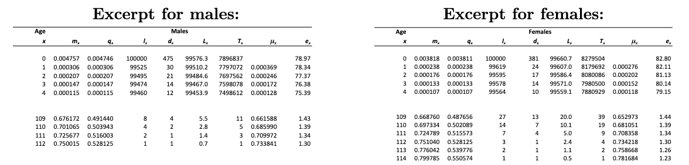

```{r setup}
#| echo: FALSE
#| output: FALSE
#| message: FALSE
knitr::opts_chunk$set(include = TRUE)
options(digits = 4)
library("tidyverse")
library("flexsurv")
library("patchwork")
```


## Recap

::: {.justify}

In the last chapter, we

- Showed that [**human lifetime**]{.alert} can be modelled as a time-to-death variable $T$ or equivalently as a two-state alive–dead process, with death as an absorbing state.

- Introduced the [**actuarial notation**]{.alert} ${}_tp_x$ for surviving a further $t$ years from age $x$ and ${}_tq_x=1-{}_tp_x$ for dying within that period. For one year, we write $p_x$ and $q_x$.

- Defined the [**force of mortality**]{.alert} $\mu_x=h_T(x)$ as the instantaneous death rate at age $x$ and linked it to survival:

  $$
  {}_tp_x=p_{11}(x,t)=\frac{S_T(x+t)}{S_T(x)}
  =\exp\!\left(-\int_x^{x+t}\mu_u\,\mathrm{d}u\right).
  $$

:::

# <span style="font-size: 42px; color: #131516; display: block; margin-bottom: -50px">[**Chapter 11:**]{.secondary} The Life Table and Life Expectancy</span>

## Life tables

:::: {.justify .small-text}

The distribution of lifetime for a population is often summarised in a [**life table**]{.alert}.



This is <a href="https://www.ons.gov.uk/peoplepopulationandcommunity/birthsdeathsandmarriages/lifeexpectancies/bulletins/englishlifetablesno17/2015-09-01" style="font-family:monospace; font-size:0.8em">English Life Tables No. 17: 2010 to 2012</a>, a life table for England.


::::

## Life table quantities $\ell_x$, $q_x$ and $d_x$ [**(Gap on page 120)**]{.alert}

:::: {.justify .small-text}

The life table summarises the distribution of a lifetime variable by presenting the function $\ell_x$ for a set of discrete values $x$.

::: {.fragment}

The number $\ell_0$ is called the [**radix**]{.alert} for the table, and

$$
\begin{aligned}
\ell_x&= \mathbb{E}[\mbox{number of survivors to exact age } x\\
&\qquad \mbox{ from an initial population of size }\ell_0]\\
&=\ell_0 \mathbb{P}(T>x)\\
&=\ell_0 S_T(x)
\end{aligned}
$$

So $\ell_x/\ell_0$ is simply the survival function $S_T(x)$ or ${}_x p_0$.

:::

::: {.fragment}

- The radix is usually a power of 10, such as $10\,000$ or $100\,000$
- The $x$ values are usually evenly spaced but need not be every year, for example every 5 years or every 10 years.

:::

::::

## The life table quantity $q_x$ [**(Gap on pages 120)**]{.alert}

:::: {.justify .small-text}

The life table usually contains a column with $q_x$ values.

If the gap between the ages $x$ is 1 year, then $q_x$ is exactly as defined in [**Section 10.5**]{.secondary}, that is

$$
\begin{aligned}
q_x=\mathbb{P}(T\le x+1|T>x)&= 1-S_T(1|x)\\[2pt] &=1-\frac{S_T(x+1)}{S_T(x)}
\end{aligned}
$$

::: {.fragment}

It follows that there is a simple relationship between $\{\ell_x\}$ and $\{q_x\}$, as
$$
q_x\;\;=\;\;1-\frac{S_T(x+1)}{S_T(x)}\;\;=\;\;1-\frac{\ell_{x+1}}{\ell_x}
$$
and
$$
\ell_{x+1}\;=\;\ell_x(1-q_x)\;\;=\;\;\ell_0\prod_{k=0}^{x}(1-q_k)
$$

If the gap between the $x$ values is $g>1$ year, then the $q_x$ should be replaced by ${}_gq_x$.

:::

::::

## The life table quantity $d_x$ [**(Gap on page 121)**]{.alert}

:::: {.justify .small-text}

The life table usually contains a column with $d_x$ values.

$$
\begin{aligned}
d_x&= \mathbb{E}[\mbox{number of deaths in } [x,x+1) \mbox{ from an initial population of size }\ell_0]\\
&=\ell_0 \mathbb{P}(x\le T<x+1)\\
&=\ell_0 [S_T(x)-S_T(x+1)]\\
&=\ell_x-\ell_{x+1}.
\end{aligned}
$$

::::

## Life expectancy [**(Gap on page 122)**]{.alert}

:::: {.justify .small-text}

The [**complete life expectancy**]{.alert} at age $x$,  $\overset{\circ}{e}_{x}$ is defined as the expected future lifetime given survival to age $x$, 
$$
\overset{\circ}{e}_x\;=\;\mathbb{E}(T-x\,|\,T>x)
$$

::: {.fragment}

The [**curtate**]{.alert} life expectancy at age $x$,  $e_{x}$ is defined as the expected future lifetime in completed years given survival to age $x$ (usually an integer),

$$
\begin{aligned}
e_x&=\mathbb{E}(\lfloor T-x \rfloor\,|\,T>x)\\
&=\sum_{k=0}^\infty k \mathbb{P}(x+k\le T< x+k+1\,|\,T>x)\\
&=\sum_{k=0}^\infty k [S_T(k|x)-S_T(k+1|x)]\\
&=\sum_{k=0}^\infty k \frac{S_T(x+k)-S_T(x+k+1)}{S_T(x)}
\end{aligned}
$$

:::

::::

## Obtaining $e_x$ from the life table [**(Gap on page 123)**]{.alert}

:::: {.justify .small-text}

If $x$ is an integer, then

$$
\begin{aligned}
e_x&=\sum_{k=0}^\infty k \frac{S_T(x+k)-S_T(x+k+1)}{S_T(x)}\\
&=\sum_{k=0}^\infty k \frac{\ell_{x+k}-\ell_{x+k+1}}{\ell_x}\\
&=\frac{1}{\ell_x}\sum_{k=0}^\infty k (\ell_{x+k}-\ell_{x+k+1})\\
&= \frac{1}{\ell_x}\sum_{k=1}^\infty \ell_{x+k}
\end{aligned}
$$

::: {.fragment}

In practice, we only need to sum up until $\ell_{x+k}\approx 0$ (typically around $x+k=120$).

:::

::::

## Obtaining $\overset{\circ}{e}_x$ from $e_x$ [**(Gap on page 124)**]{.alert}

:::: {.justify .small-text}

The complete expectation of life $\overset{\circ}{e}_x$ includes fractional parts of a year between an individuals last birthday (the death age for the purposes of calculation of $e_x$) and the actual date of death. Hence
$$
e_x \le \overset{\circ}{e}_x < e_x+1.
$$

::: {.fragment}

If we make the assumption that, in every age interval $[x,x+1)$, [**deaths are uniformly distributed**]{.alert}, then we have
$$
\overset{\circ}{e}_x = e_x+\frac{1}{2}.
$$
This gives a reasonable approximation to $\overset{\circ}{e}_x$ which can then be computed using life table data.

:::

::: {.fragment}

However, in cases where the $x$ values are not evenly spaced, or when the assumption that deaths are evenly distributed over $[x,x+1)$ is unreasonable (for example in the first year of life) then an alternative approach is required to compute $\overset{\circ}{e}_x$.

:::

::::

## Obtaining $\overset{\circ}{e}_x$ from irregular life table [**(Gap on page 124)**]{.alert}

:::: {.justify .small-text}

We have

$$
\begin{aligned}
\overset{\circ}{e}_x= \mathbb{E}(T-x|T>x)&=\int_0^\infty S_T(t|x)\mathrm{d}t\\
&=\int_0^\infty  \frac{S_T(x+t)}{S_T(x)}\mathrm{d}t\\
&=\frac{1}{\ell_x}\int_0^\infty  \ell_0 S_T(x+t)\mathrm{d}t\\
&=\frac{1}{\ell_x}\int_x^\infty  \ell_0 S_T(t)\mathrm{d}t\\
 &=\frac{1}{\ell_x}\sum_{i=1}^{\infty} \int_{x_{i-1}}^{x_i}  \ell_0 S_T(t)\mathrm{d}t
\end{aligned}
$$

where $x=x_0<x_1<x_2\cdots$ are the ages $\ge x$ represented in the life table.

::::

## Expectation of life in an interval [**(Gap on page 125)**]{.alert}

:::: {.justify .small-text}

Define ${}_{s}L_x$ to be the expected total years lived between ages $x$ and $x+s$ by an initial population of size $\ell_0$. Then
$$
{}_{s}L_x\;\;=\;\; {}_{\infty}L_x-{}_{\infty}L_{x+s}
$$

::: {.fragment}

where
$$
{}_{\infty}L_x\;\;=\;\; \ell_0 \mathbb{P}(T>x) \overset{\circ}{e}_x\;\;=\;\; 
\ell_0 \frac{\ell_x}{\ell_0}\frac{1}{\ell_x}\int_x^\infty  \ell_0 S_T(t)\mathrm{d}t\;\;=\;\;
\int_x^\infty  \ell_0 S_T(t)\mathrm{d}t.
$$

:::

::: {.fragment}

Therefore,
$$
{}_{s}L_x\;\;=\;\; \int_x^{x+s}  \ell_0 S_T(t)\mathrm{d}t
$$

The quantity ${}_{\infty}L_x$, the expected total  years lived after age $x$ by an initial population of size $\ell_0$, is usually denoted by $T_x$.

:::

::::

## Life expectancy using $L_x$ and $T_x$ [**(Gap on page 126)**]{.alert}

:::: {.justify .small-text}

It follows from [**Section 11.3.3**]{.secondary} and [**Section 11.3.4**]{.secondary} that life expectancy at birth is

$$
\begin{aligned}
\overset{\circ}{e}_x&=\frac{1}{\ell_x}\int_x^\infty  \ell_0 S_T(t)\mathrm{d}t\;\;=\;\;\frac{T_x}{\ell_x}\\
&=\frac{1}{\ell_x}\sum_{i=1}^{\infty} \int_{x_{i-1}}^{x_i}  \ell_0 S_T(t)\mathrm{d}t\;\;=\;\; \frac{1}{\ell_x}\sum_{i=1}^{\infty} {}_{x_{i}-x_{i-1}}L_{x_{i-1}}
\end{aligned}
$$

::: {.fragment}

When $t=1$, ${}_{t}L_x$ is simply denoted by $L_x$.

Therefore, for a life table with annual spacing, $x_0=x$, $x_1=x+1,\ldots$, we have 
$$
\overset{\circ}{e}_x\;\;=\;\;\frac{T_x}{\ell_x}\;\;=\;\; \frac{1}{\ell_x}\sum_{t=0}^{\infty} L_{x+t}
$$

:::

::: {.fragment}

Life tables often present values of $T_x$ and (or) $L_x$.

:::

::::

## The trapezium rule approximation [**(Gap on page 127)**]{.alert }{.limit-code}

:::: {.justify .small-text}

To obtain $\overset{\circ}{e}_x$, we need to approximate 
${}_{x_{i}-x_{i-1}}L_{x_{i-1}}=\int_{x_{i-1}}^{x_i}  \ell_0 S_T(t)\mathrm{d}t$
where the only relevant values of the integrand that we know are at the endpoints
$$
\ell_0 S_T(x_{i-1})=\ell_{x_{i-1}}\qquad\mbox{and}\qquad\ell_0 S_T(x_i)=\ell_{x_i}
$$

::: {.fragment}

We use the [**trapezium rule approximation**]{.alert}.

```{r, echo = TRUE, fig.width = 8, fig.height = 4, fig.align = "center", out.width = "72%"}
x_left <- 1.5
x_right <- 3.5
y_left <- exp(-x_left)
y_right <- exp(-x_right)

draw_panel <- function(trapezium = FALSE) {
  plot(NA_real_, NA_real_, xlim = c(0, 5), ylim = c(0, 0.36),
       xaxs = "i", yaxs = "i", axes = FALSE,
       xlab = "Time", ylab = expression("\u2113"[0] * S[T](t)))

  axis(1, at = c(x_left, x_right), labels = expression(x[i - 1], x[i]),
       lwd = 0, lwd.ticks = 1)
  axis(2, at = c(y_right, y_left),
       labels = expression("\u2113"[i], "\u2113"[i - 1]),
       lwd = 0, lwd.ticks = 1)

  segments(0, c(y_left, y_right), c(x_left, x_right),
           c(y_left, y_right), lty = 2, col = "grey45")

  if (trapezium) {
    top_x <- c(x_left, x_right)
    top_y <- c(y_left, y_right)
  } else {
    top_x <- seq(x_left, x_right, length.out = 200)
    top_y <- exp(-top_x)
  }

  polygon(c(x_left, top_x, x_right), c(0, top_y, 0),
          density = 12, angle = 45, col = "black", border = "black")

  curve(exp(-x), from = 1, to = 4, add = TRUE, lwd = 1.5)
  box(bty = "l")
}

old_par <- par(mfrow = c(1, 2), mar = c(3.3, 3.9, 0.8, 0.6),
               mgp = c(2.1, 0.6, 0))
draw_panel()
draw_panel(trapezium = TRUE)
```

:::

::::

## The trapezium rule approximation [**(Gap on page 127)**]{.alert}

:::: {.justify .small-text}

$$
{}_{x_{i}-x_{i-1}}L_{x_{i-1}}\;\;=\;\;\int_{x_{i-1}}^{x_i}  \ell_0 S_T(t)\mathrm{d}t\;\;\approx\;\;(x_i-x_{i-1})\frac{\ell_{x_i}+\ell_{x_{i-1}}}{2}
$$
so, when $x_i-x_{i-1}=1$ for all $i$, we have $L_x\approx(\ell_{x+1}+\ell_x)/2$ 
which gives the expression in [**Section 11.3.2**]{.secondary} when substituted into $\overset{\circ}{e}_x=\frac{1}{\ell_x}\sum_{t=0}^{\infty} L_{x+t}$.

::::

## Concluding remarks: Period life tables

:::: {.justify .small-text}

The life table <a href="https://www.ons.gov.uk/peoplepopulationandcommunity/birthsdeathsandmarriages/lifeexpectancies/bulletins/englishlifetablesno17/2015-09-01" style="font-family:monospace; font-size:0.8em">English Life Tables No. 17: 2010 to 2012</a> in [**Section 11.1**]{.secondary} is a [**period life table**]{.alert}.

That means that the table was constructed by estimating $q_x$ from mortality data over a particular period in time (here 2010-2012).

::: {.fragment}

- $q_{21}$ is estimated using individuals born around 1990,
- $q_{81}$ is estimated using individuals born around 1930, etc.

:::

::: {.fragment}

So the table does not actually describe the distribution of lifetime of any actual individual or group of individuals.

- Individuals born around 1990 will expect to experience a different (lower?) $q_{81}$ in 2071.
- Individuals born around 1930 experienced a higher $q_{21}$ in 1951.

:::

::::

## Concluding remarks: Cohort life tables

:::: {.justify .small-text}

A life table describing the mortality experience of a particular population, as it develops over time is called a  [**cohort life table**]{.alert}.

A [**cohort**]{.alert} is the name given to a population all born at or around the same time (typically in the same calendar year).

::: {.fragment}

The cohort life table estimates $q_x$ based on the mortality experience of the cohort at that age.

:::

::: {.fragment}

The problem with a cohort life table is that it cannot be completed until the cohort have died out, by which point it is only really of interest to historians!

:::

::::
