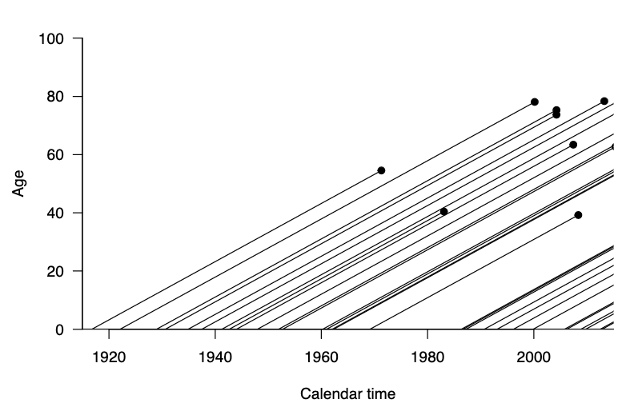
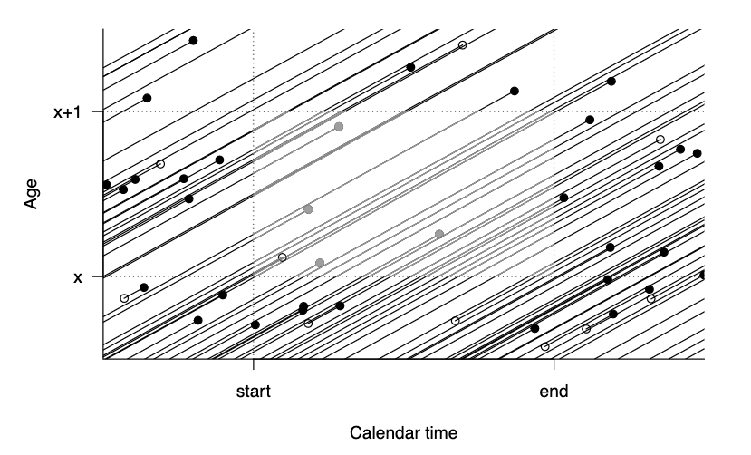

```{r setup}
#| echo: FALSE
#| output: FALSE
#| message: FALSE
knitr::opts_chunk$set(include = TRUE)
options(digits = 4)
library("tidyverse")
library("flexsurv")
library("patchwork")
```


## Recap

::: {.justify}

In the last chapter, we

- Used the [**binomial model**]{.alert} to estimate the annual probability of death $q_x$ and used interpolation when individuals were observed for only part of a year of age.

- Distinguished [**initial exposed to risk**]{.alert} $E_x^0$ from [**central exposed to risk**]{.alert} $E_x^C$ and used them to construct estimators of $q_x$.

- Used the [**two-state and Poisson models**]{.alert} to obtain the crude central mortality rate $\hat m_x=D_x/E_x^C$.

:::

# <span style="font-size: 42px; color: #131516; display: block; margin-bottom: -50px">[**Chapter 14**]{.secondary}: Exposure to Risk</span>

## Central exposed to risk

:::: {.justify .small-text}

As defined in [**Chapter 13**]{.secondary},

The central exposed to risk at age $x$, $E^C_x$ is the total time of observation in the age range $[x,x+1)$ of all individuals under study, where observation ends either with death, censoring, or the end of the study period.

::: {.fragment}

$$
E_x^C\;=\;\sum_{i=1}^n (b'_i-a_i)\tag{1}
$$

where

- $a_i$ is the earliest age in $[x,x+1)$ at which individual $i$ was observed within the study period and

- $b'_i$ is the latest age in $[x,x+1)$ at which individual $i$ was alive and observed within the study period.

:::

::::

## Calculating $E^C_x$

:::: {.justify .small-text}

The central exposed to risk at age $x$, $E^C_x$ can be calculated using [**Equation $(1)$**]{.secondary} if we have records, at individual level, of precise ages at entry into the study and at death or other exit from the study.

::: {.fragment}

However, in mortality studies, records are often secondary data sources where such precise information is not available. For example, it is common to have records of

- the number of deaths in the age range $[x,x+1)$ within the study period,

- the total number of individuals within particular age ranges, such as $[x,x+1)$, at set dates (often January 1 each year), and

- nothing else.
:::

::: {.fragment}

How can we calculate $E^C_x$ using such information?

:::

::::

## Lexis diagrams

:::: {.justify .small-text}

The [**Lexis diagram**]{.alert} is a useful way of visualising lifetime data.

It plots an individual life trajectory as a line on a graph where the $y$-axis is age and the $x$-axis is calendar year.

The following Lexis diagram shows 30 randomly selected lives born between 1915 and 2015. A death (before end 2014) is marked by a solid circle.



::::

## Lexis diagram over a study period

:::: {.justify .small-text}

The lifetimes which are relevant for the calculation of $E^C_x$ can be identified in the Lexis diagram.



Life lengths included in the calculation of $E^C_x$ (for the study period with start and end dates identified) are identified in grey. Deaths included in the calculation of $\hat{\mu}_{x+\frac12}$ and/or $\hat{q}_x$ are identified in grey.
Observation periods which end for reason other than birth and death are identified by unfilled circles.

:::

## Calculating $E_x^C$

:::: {.justify .small-text}

The central exposed to risk at age $x$, $E^C_x$ is the total time represented by all the grey lines in the picture in [**Section 14.2.1**]{.secondary}.

::: {.fragment}

If we denote by $P_{x}(t)$ the number of individuals in our study with ages in the interval $[x,x+1)$ at exact time $t$ (the number of grey lines crossing the vertical line, calendar time $=t$), then

$$
E^C_x\;=\;\int_{t_0}^{t_f} P_{x}(t)\mathrm{d}t
$$

where $t_0$ and $t_f$ are the start and end dates of the study, respectively.

:::

::::

## Approximating $E_x^C$ [**(Gap on page 159)**]{.alert}

:::: {.justify .small-text}

In practice, we do not know $P_{x}(t)$ for every calendar time $t$, but we typically have census data which gives (or allows us to approximate) $P_{x}(t)$ for certain values of $t$.

::: {.fragment}

Then, we approximate $E_x^C$ using the [**trapezium rule**]{.alert}, which approximates $P_{x}(t)$ by a linear function between the known values.

```{r, echo = FALSE, fig.width = 8, fig.height = 3.75, fig.align = "center"}
census_times <- c(1:4, 6, 8:10) / 10
population <- dnorm(census_times, mean = 0.4, sd = 0.5)
start <- 0.25
end <- 0.85
breaks <- c(start, census_times[census_times > start & census_times < end], end)
heights <- approx(census_times, population, xout = breaks)$y

plot(NA_real_, NA_real_, xlim = c(0.08, 1), ylim = c(0, max(population)),
     xlab = "t", ylab = expression(P[x](t)), axes = FALSE,
     xaxs = "i", yaxs = "i", bty = "l")
axis(1, at = c(start, end), labels = expression(t[0], t[f]))
box(bty = "l")
polygon(c(start, breaks, end), c(0, heights, 0),
        density = 8, angle = 45, border = NA)
segments(census_times, 0, census_times, population, lty = 3)
lines(census_times, population)
```

::: {style="margin-top: -50pt;"}
Trapezium rule approximation to $E^C_x$ over the period $[t_0,t_f]$ is given by the shaded area. Census times (at which values of $P_{x}(t)$ are available) are indicated by the vertical dotted lines.
:::

:::

::::

## Approximating $E_x^C$ [**(Gap on page 160)**]{.alert}

:::: {.justify .small-text}

If $P_{x}(t)$ is available at $t_0, t_1,\ldots ,t_{f-1},t_f$ then the trapezium rule for $E^C_x$ over the period $[t_0,t_f]$ is

$$
E^C_x\;=\;\int_{t_0}^{t_f} P_{x}(t)\mathrm{d}t\;\approx\; \sum_{i=1}^f \frac{1}{2}[P_{x}(t_i)+P_{x}(t_{i-1})](t_i-t_{i-1})
$$

::: {.fragment}

This is known as the [**census approximation**]{.alert} for the central exposed to risk.

:::

::::

## Approximating $E_x^C$ [**(Gap on page 160)**]{.alert}{.limit-code-3}

:::: {.justify .small-text}

When there is census information at $t_0$ and $t_f$ but at no time in between, we have

$$
E^C_x\;=\;\int_{t_0}^{t_f} P_{x}(t)\mathrm{d}t\;\approx\; \frac{1}{2}[P_{x}(t_0)+P_{x}(t_{f})](t_f-t_{0})
$$
```{r, echo = TRUE, fig.width = 8, fig.height = 3.75, fig.align = "center"}
times <- c(0.1, 0.9)
population <- dnorm(times, mean = 0.4, sd = 0.5)

plot(NA_real_, NA_real_, xlim = c(0, 1), ylim = c(0, max(population)),
     xlab = "Time", ylab = expression(P[x](t)), axes = FALSE,
     xaxs = "i", yaxs = "i", bty = "l")
axis(1, at = times, labels = expression(t[0], t[f]))
box(bty = "l")
polygon(c(times[1], times, times[2]), c(0, population, 0),
        density = 8, angle = 45, border = "black")
```

::: {style="margin-top: -60pt;"}
If $t_f-t_0=1$ year, then $E^C_x$ is an estimate of the [**mid-year pop. at age $x$**]{.secondary} (pop. at time $t_0+1/2$).
:::

::::


## The principle of correspondence

:::: {.justify .small-text}

The principle of correspondence as it applies to the estimation of mortality rates states that

:::{.callout-important}
A person alive at time $t$ should be included in the exposure at age $x$ at time $t$ if and only if, were that person to die immediately, it would be counted in the deaths data at age $x$.
:::

:::{.fragment} 

In other words, given the mortality estimator $\widehat{m}_x = \frac{D_x}{E_x^C}$, [*include a person’s time in the denominator exactly when an immediate death of that person would be included in the numerator.*]{.alert}

:::

::: {.fragment}

Thus far, we have been careful to respect this principle. For example, this is why lives entering into a study at age $x+t$ where $0<t<1$ can only be counted towards the exposure from  age $x+t$ (even though we know they were alive at ages between $x$ and $x+t$).

[It is important to bear this principle in mind when data on deaths and census data use different age definitions.]{.secondary}

:::

::::

## Age definitions

:::: {.justify .small-text}

Ages may be defined by

- Age at last birthday, so ages in $[x,x+1)$ are recorded as $x$.

- Age at next birthday, so ages in $[x-1,x)$ are recorded as $x$.

- Age at nearest birthday, so ages in $\left[x-\frac{1}{2},x+\frac{1}{2}\right)$ are recorded as $x$.

::: {.fragment}

If data on deaths and census data use different age definitions, then we transform (approximately) the census data to match the definition used in the death records, $\{D_x\}$.

This is generally straightforward.

:::

::: {.fragment}

For example if death data uses age at last birthday, and census data $P_x(t)$ records age at next birthday, then the census approximation

$$
E^C_x\;\approx\; \sum_{i=1}^f \frac{1}{2}[P_{x}(t_i)+P_{x}(t_{i-1})](t_i-t_{i-1})
$$

needs to be amended with $P_x$ replaced by $P_{x+1}$.

:::

::::

## Half year adjustments

:::: {.justify .small-text}

Where census ages are defined by age at last birthday or age at next birthday and need to be adjusted to age at nearest birthday, or vice versa, then some further approximation is required.

::: {.fragment}

Suppose that $P_x(t)$ records age at nearest birthday, but we require the number of lives aged $x$ at last birthday (at time $t$). Then, at time $t$

- those lives with ages in $\left[x,x+\frac{1}{2}\right)$ are counted within $P_x(t)$

- those lives with ages in $\left[x+\frac{1}{2},x+1\right)$ are counted within $P_{x+1}(t)$

:::

::: {.fragment}

If we make the additional assumption that, within each age $x$, the $P_x(t)$ birthdays are uniformly distributed through the calendar year, then the  census count at time $t$ under our required age definition (aged $x$ at last birthday) is

$$
\frac{1}{2}\left[P_x(t)+P_{x+1}(t)\right]
$$

Other examples are similar. [**Just use common sense!**]{.alert}

:::

::::

## Presenting the estimates

:::: {.justify .small-text}

Care needs to be taken to be clear about which age range any estimated mortality rates $\hat{\mu}$ and estimated death probabilities $\hat{q}$ correspond to.

Recall that in the standard approach, where the age in the definition of deaths (and hence for the calculation of estimates) is age at last birthday, we use $q_x$ to indicate a probability of death in $[x,x+1)$ given survival to $x$ and $\mu_{x+\frac12}$ to indicate a constant force of mortality over $[x,x+1)$.

::: {.fragment}

If a different age definition is used for deaths, then we need to adjust these subscripts accordingly, so that the subscript on $q$ is still the start of the interval, and the subscript on $\mu$ is the middle of the interval.

- For age at nearest birthday, our age range is $\left[x-\frac{1}{2},x+\frac{1}{2}\right)$ and hence we are estimating $q_{x-\frac{1}{2}}$ and $\mu_x$.

- For age at next birthday, our age range is $[x-1,x)$ and hence we are estimating $q_{x-1}$ and $\mu_{x-\frac{1}{2}}$.

:::

::::

## Rate interval

:::: {.justify .small-text}

A mortality rate is defined with respect to a particular [**rate interval**]{.alert}, the period over which a life has a particular age for the purposes of calculation of the mortality rate.

We have focused on [**life year rate intervals**]{.alert} where a life changes age at a date determined by birthday (either on the birthday or at the midpoint between birthdays).

::: {.fragment}

Other possibilities are used when exact birthdays are unknown

- Policy year rate intervals, where a life changes age at a fixed date annually (usually the anniversary date of a particular insurance policy): used when only age at last birthday, at inception of policy, is known.

- Calendar year rate intervals, where a life changes age annually on January 1: used when year of birth is known.

The correct calculation in these cases can be derived by constructing the Lexis diagram where the $y$-axis is  age as defined by the rate interval.

:::

::::
